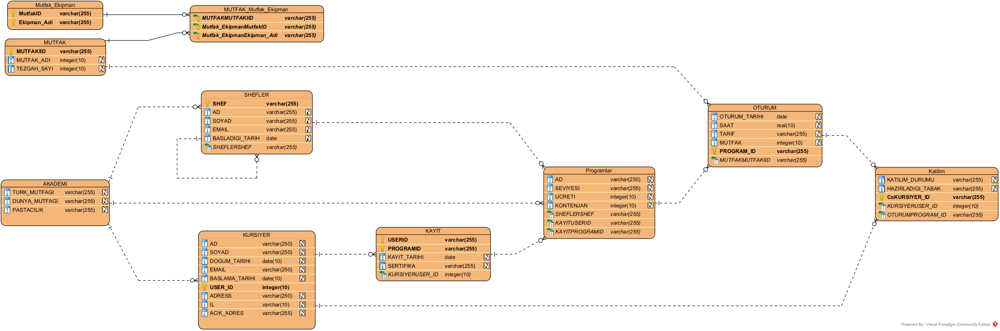

# Lab 01 - Entity-Relationship Diagram Design

## Overview

This laboratory assignment focuses on designing an Entity-Relationship (ER) diagram for a culinary academy management system using Visual Paradigm.

## Case Study

**Usta Eller Culinary Academy**

The database model includes:

- Students and departments
- Chefs and mentorship relationships
- Training programs and enrollments
- Practical sessions and kitchens
- Kitchen equipment
- Student attendance and performance

## Concepts Covered

- Entity-Relationship Modeling
- Primary and Foreign Keys
- Relationship Cardinalities
- Recursive Relationships
- Many-to-Many Relationships
- Associative Entities

## ER Diagram

## Tools Used

- Visual Paradigm

## Project Files

- `241113_uyg1C.vpp` - Visual Paradigm project
- `241113_uyg1C.png` - ER diagram image
